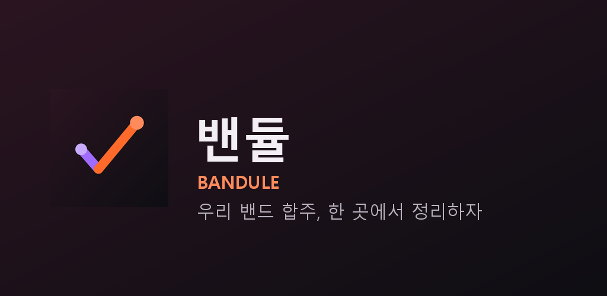
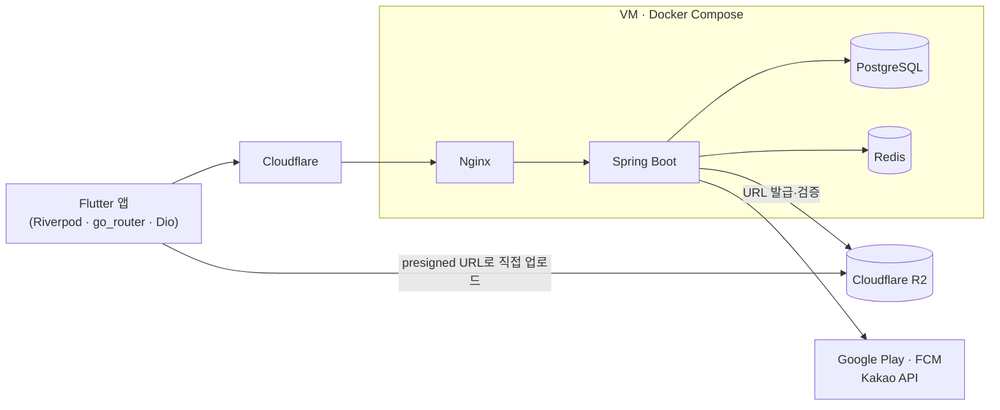

<div align="center">



# 밴듈 — 밴드 합주 관리 앱

합주 일정·참석·셋리스트·비용 정산·연습 영상을 **밴드 단위로** 기록하고 공유하는 모바일 앱

`Java 21` `Spring Boot 3.4` `PostgreSQL` `Redis` `Flutter` `Docker` `GitHub Actions`

</div>

---

## 어떤 문제를 푸나

합주 날짜는 단톡방에 흩어지고, 합주비는 누가 냈는지 매번 헷갈리고, 연습 영상은 각자 휴대폰에만 남습니다.
밴듈은 이것을 밴드가 함께 쓰는 하나의 기록장으로 모읍니다.

합주실 예약을 대행하지 않는 **기록용 도구**라는 점이 설계의 출발점입니다. 예약은 전화·메신저로 이미 끝났고,
앱은 그 결과를 남깁니다. 그래서 시간이 겹치는 일정도 막지 않고 저장한 뒤 경고만 돌려줍니다.

## 주요 기능

| 기능 | 내용 |
|---|---|
| 합주 일정 | 캘린더, 합주실·비용·메모 기록, 시간 겹침 경고 |
| 정기 합주 | 매주·격주·매월 반복 규칙으로 회차 자동 생성 |
| 참석·셋리스트 | 참석 여부 체크, 곡 순서 정리 |
| 합주비 정산 | n분의 1 / 실제 참석자 기준 분담 계산, 납부 체크리스트 |
| 합주실 지도 | 주소 검색(카카오 로컬 API)으로 등록, 지도에 표시 |
| 게시판 | 사진·영상 업로드와 앱 내 재생 |
| 알림 | 일정·정산 푸시(FCM), 알림 종류별 설정 |
| 구독 | Google Play 인앱 결제로 밴드 단위 프리미엄 |
| 계정 | 이메일·카카오 로그인, 초대 코드로 밴드 합류 |

## 아키텍처



- **모듈형 모놀리스** — `user` `band` `room` `reservation` `recurring` `settlement` `board` `notification` `plan`
  도메인별 패키지로 경계를 나누고 서비스 레이어로만 참조합니다. 1인 운영 규모에서 마이크로서비스는 비용일 뿐이라,
  나중에 분리할 수 있게 경계만 세워 두었습니다.
- **스키마는 Flyway 마이그레이션으로만** 바꾸고 JPA는 `ddl-auto: validate` 로 검증만 합니다.

## 기술적으로 고민한 것

**대용량 미디어는 서버를 거치지 않는다**
소형 VM이 영상 스트림을 중계하면 곧바로 병목이 됩니다. 서버는 R2 presigned URL 발급과 업로드 완료 검증만 하고,
클라이언트가 업로드 전에 영상(720p·2~3Mbps)과 이미지를 압축해 스토리지로 직접 올립니다.

**외부 HTTP 호출을 트랜잭션 밖으로**
카카오·Google Play 같은 외부 API를 `@Transactional` 안에서 부르면, 응답을 기다리는 동안 DB 커넥션을 붙잡아
커넥션 풀이 마릅니다. 외부 I/O를 먼저 끝내고 확정된 값만 짧은 트랜잭션으로 쓰며,
동시 쓰기 경합은 유니크 제약 위반을 잡아 도메인 예외로 바꿉니다.

**JWT 인증과 토큰 회전**
Access 토큰은 짧게, Refresh 토큰은 Redis에 저장해 사용할 때마다 회전합니다. 네트워크 재시도로 같은 Refresh 토큰이
두 번 들어오는 경우를 위해 짧은 유예 구간을 두었고, 로그아웃한 Access 토큰은 Redis 블록리스트로 즉시 무효화합니다.

**스토어 구독 결제**
클라이언트가 구매하고, 서버는 Google Play Developer API로 구매 토큰을 검증합니다. 갱신·해지·환불은
실시간 개발자 알림(Pub/Sub 웹훅)으로 받아 반영합니다. 웹훅은 OIDC 토큰으로 발신자를 검증하고,
같은 이벤트가 중복 도착해도 한 번만 처리합니다. 결제한 멤버가 밴드를 떠나는 경우처럼
"구독은 밴드 것, 결제는 개인 것" 이라 생기는 경계 상황을 따로 다룹니다.

**권한 경계**
모든 API는 요청자가 해당 밴드의 멤버인지 검증해 다른 밴드 데이터에 접근할 수 없게 합니다.
Controller는 DTO(`record`)만 다루고 엔티티를 노출하지 않습니다.

## 테스트와 배포

- **테스트** — 백엔드 통합 테스트는 Testcontainers로 실제 PostgreSQL·Redis를 띄워 실행합니다
  (테스트 586개). Flutter 위젯·단위 테스트를 별도 CI로 돌립니다.
- **CI/CD** — `main` 의 CI가 통과하면 Docker 이미지를 GHCR에 올리고 VM에 SSH로 배포합니다.
  배포 직전 DB 백업을 남기고, 새 컨테이너가 헬스 체크를 통과해야 교체합니다.
- **운영** — Nginx는 Cloudflare 대역에서 온 요청만 실제 클라이언트 IP로 인정합니다. DB는 매일 공개키로 암호화해
  R2에 백업하고, 정기 점검 워크플로가 서버 상태·오류 로그·인증서 만료를 확인해 메일로 알립니다.
- **보안 사고와 재발 방지** — 설정 파일 사본이 공개 저장소에 커밋된 적이 있어, 모든 비밀값을 교체하고
  비밀 파일 이름 패턴을 막는 pre-commit 훅과 커밋 규칙을 만들었습니다.

설계 결정의 배경은 [docs/DESIGN.md](docs/DESIGN.md), 실제로 겪은 문제와 원인·해결은
[docs/TROUBLESHOOTING.md](docs/TROUBLESHOOTING.md)에 기록했습니다.

## 로컬 실행

```bash
docker compose up --build              # app + postgres + redis
curl localhost:8080/actuator/health    # {"status":"UP"}
./gradlew test                         # 통합 테스트 (Docker 필요)
```

로컬에 JDK 21이 없어도 Gradle toolchain이 자동으로 받아옵니다. 클라이언트는 [client/](client/)를 참고하세요.

## 디렉터리

```
src/main/java/com/yeka/bandapp/   백엔드 (도메인별 패키지)
src/main/resources/db/migration/  Flyway 마이그레이션
client/                           Flutter 앱
deploy/                           배포 스크립트 · Nginx · 백업
.github/workflows/                CI · 배포 · 운영 점검
docs/                             설계 문서 · 문제 기록
```
